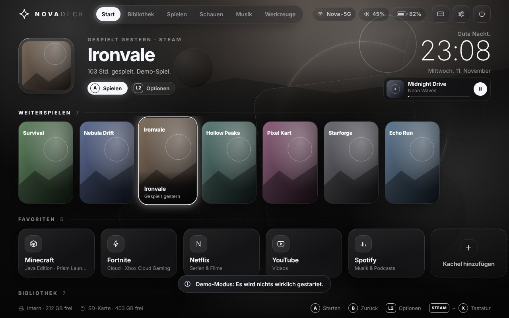
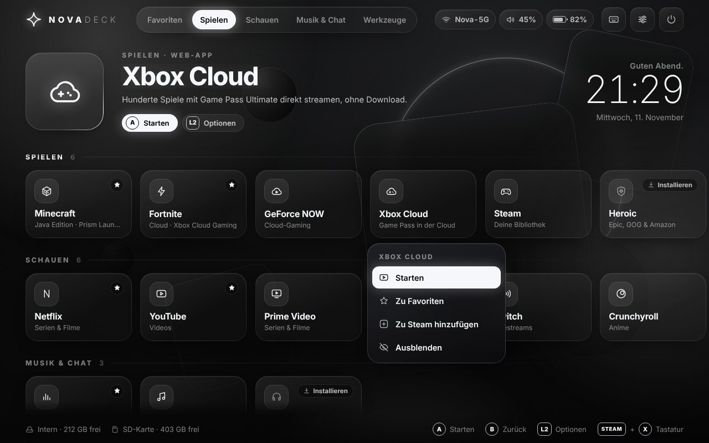
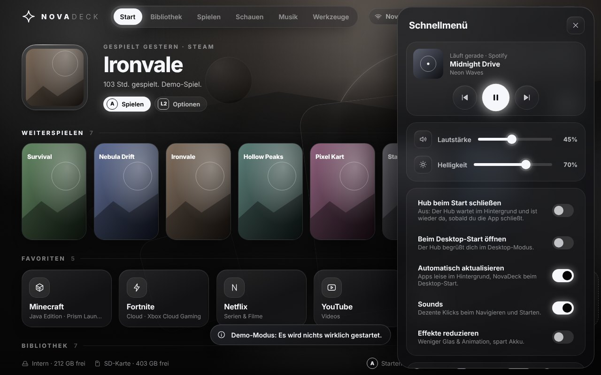
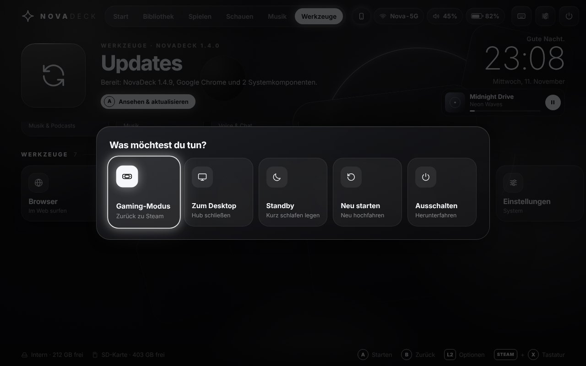
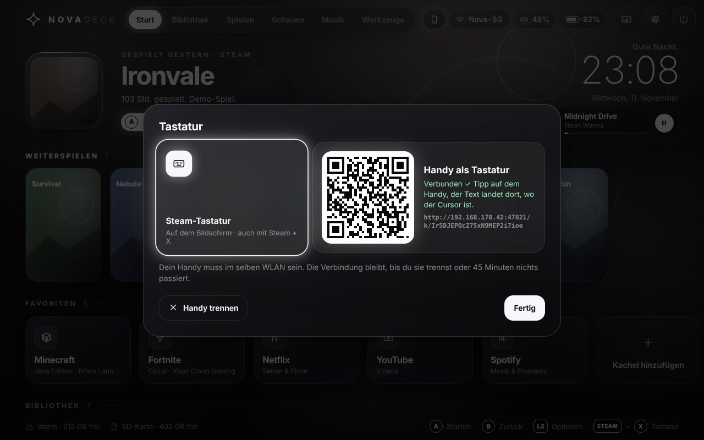
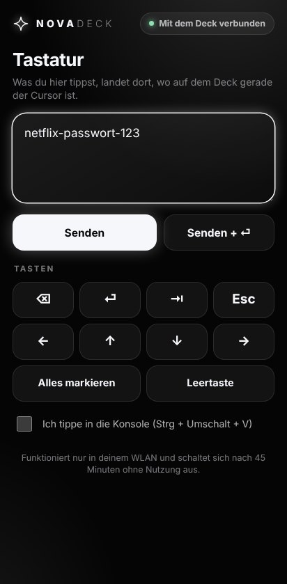
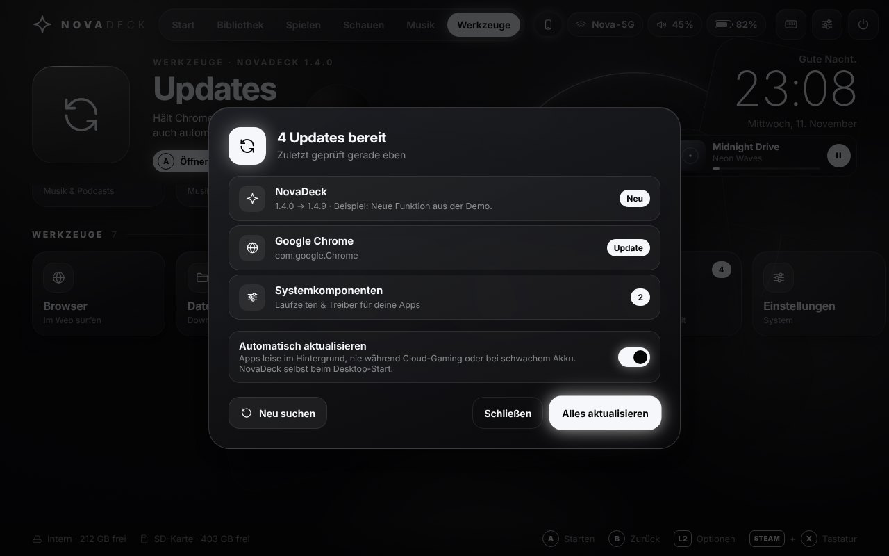

# ✦ NovaDeck

**Dein Steam-Deck-Desktop, aufgeräumt.**
NovaDeck macht aus dem Desktop-Modus des Steam Deck eine saubere, per Controller bedienbare Oberfläche im Glas-Look: schwarz, grau, neon-weiß. Minecraft, Fortnite, Netflix, YouTube und Spotify liegen einen Knopfdruck entfernt, ohne Umwege über Menüs, Browser-Tabs oder Terminal.

Der **Gaming-Modus (Big Picture) bleibt genau so, wie er ist.**



---

## Was du bekommst

| | |
|---|---|
| **NovaDeck Hub** | Ein Vollbild-Startbildschirm wie bei einer Konsole. Bedienung mit Steuerkreuz, A und B, per Touchscreen oder Trackpad. Zeigt Uhrzeit, Akku, WLAN, Lautstärke und freien Speicher. |
| **Deine Spiele mit echten Covern** | Reihen *Weiterspielen* und *Bibliothek* mit deinen Steam-Spielen im echten Cover-Artwork, dazu deine Minecraft-Instanzen zum Direktstart. Beim Auswählen erscheint groß das Artwork des Spiels. |
| **Handy als Tastatur** | QR-Code scannen, auf dem Handy tippen: Der Text landet auf dem Deck, auch Passwörter, Umlaute und Emojis. |
| **Musik-Karte** | Was auf Spotify, YouTube Music & Co. läuft, mit Cover unter der Uhr. Pause/Weiter im Schnellmenü. |
| **Hub kommt zurück** | Startest du etwas, tritt der Hub zur Seite. Schließt du die App, ist er automatisch wieder da. |
| **Apps als echte Apps** | Netflix, YouTube, Prime Video, Disney+, Twitch, Crunchyroll, YouTube Music, Fortnite (Cloud), Xbox Cloud und GeForce NOW öffnen sich als eigene App-Fenster ohne Browser-Leisten. |
| **Ein-Klick-Installation** | Fehlt eine App (z. B. Spotify oder Discord), drückst du A auf der Kachel und NovaDeck installiert sie aus Flathub, ohne Passwort. |
| **Updates ohne Nachdenken** | Die Kachel *Updates* aktualisiert Chrome, Minecraft-Launcher, Spotify & Co. mit einem Druck auf A. Automatisch läuft das auch leise im Hintergrund, aber nie während Cloud-Gaming und nicht bei schwachem Akku. |
| **NovaDeck aktualisiert sich selbst** | Beim Wechsel in den Desktop-Modus holt sich NovaDeck die neueste Version von GitHub. Du musst nie wieder etwas herunterladen. |
| **Glas-Design für den ganzen Desktop** | Farbschema „Nova Glass“, Glas-Wallpaper, durchscheinende Leiste mit Blur, eigener Startbildschirm beim Wechsel in den Desktop-Modus, Terminal im gleichen Look. |
| **Aufgeräumte Leiste** | Unten nur noch das Wichtige: NovaDeck, Steam, Browser, Dateien, App Store, Tastatur, Einstellungen. |
| **Schnellmenü** | Lautstärke, Helligkeit, Speicheranzeige, eigene Kacheln, Ausgeblendetes, Einstellungen. |
| **Ein/Aus-Menü** | Zurück in den Gaming-Modus, Standby, Neustart und Ausschalten, alles mit dem Controller. |
| **Eigene Kacheln** | Jede Website als App-Kachel: ARD Mediathek, Joyn, WhatsApp Web und alles andere. |
| **Nichts geht kaputt** | Alles liegt in deinem Home-Ordner und übersteht SteamOS-Updates. Kein `sudo`, kein Entsperren des Systems. Jede Änderung lässt sich mit einem Klick rückgängig machen. |

<p>
  
  
</p>

---

## Installation (ca. 5 Minuten)

### 1. In den Desktop-Modus wechseln
Steam-Taste → **Ein/Aus** → **Zum Desktop wechseln**.

### 2. NovaDeck installieren
Du brauchst kein GitHub-Konto. Such dir einen Weg aus:

**Variante A: Einzeiler (am schnellsten)**
Diese Seite auf dem Deck im Browser öffnen, die Zeile unten markieren und kopieren. Dann **Konsole** öffnen (App-Menü → System → Konsole), Rechtsklick (L2) → **Einfügen**, Enter.
```bash
curl -fsSL https://raw.githubusercontent.com/TechNova-App-Team/Steamdeck-linux/HEAD/install.sh | bash
```

**Variante B: als ZIP**
1. Grüner Button **Code** → **Download ZIP**.
2. Im Dateimanager (Dolphin) unter *Downloads*: Rechtsklick (L2) auf die ZIP → **Entpacken → Hierher entpacken**.
3. Im entpackten Ordner auf **`install.sh`** tippen und **Ausführen** wählen. Ein Terminalfenster öffnet sich automatisch.

Passiert bei Schritt 3 nichts, fehlt nach dem Entpacken das Ausführen-Recht: Rechtsklick auf `install.sh` → **Eigenschaften → Berechtigungen → „Ausführbar“** anhaken. Oder in der Konsole im entpackten Ordner `bash install.sh` eingeben.

### 3. Auswählen, was du willst

Der Installer zeigt eine Liste, in der du auswählst, was eingerichtet wird:

- ☑ Glas-Design für den Desktop
- ☑ NovaDeck beim Wechsel in den Desktop-Modus automatisch öffnen
- ☑ Google Chrome (für Netflix, YouTube, Fortnite-Cloud & Co.)
- ☑ Prism Launcher (Minecraft)
- ☐ Spotify, Discord, Heroic, VLC
- ☐ Bildschirmsperre im Desktop-Modus abschalten

Alles, was du hier weglässt, kannst du später per Knopfdruck im Hub nachinstallieren.

> **Tipp:** Wechsle nach der Installation einmal in den Gaming-Modus und zurück. Dann ist das Design überall aktiv, auch in schon geöffneten Programmen.

Das war's. Ab jetzt aktualisiert sich NovaDeck selbst.

---

## Bedienung

Steam leitet im Desktop-Modus die Tasten des Decks als Tastatur und Maus weiter. NovaDeck ist genau darauf abgestimmt.

| Deck | Tastatur | Im Hub |
|---|---|---|
| Steuerkreuz | Pfeiltasten | Kacheln auswählen |
| **A** | Enter | Starten / Bestätigen |
| **B** | Esc | Zurück / Schließen |
| **L2** (Rechtsklick) | `X` / Kontextmenü-Taste | Optionen: Favorit, Ausblenden, Zu Steam hinzufügen |
| Touchscreen, rechtes Trackpad | Maus | Antippen = auswählen, nochmal antippen = starten |
| **Steam + X** | | Bildschirmtastatur (oder Tastatur-Knopf oben → Handy als Tastatur) |
| | `Tab` / `Q` `E` | Nächste / vorherige Reihe |
| | `O` | Schnellmenü |
| | `P` | Ein/Aus-Menü |

Ist ein Controller direkt im Browser sichtbar (z. B. ein externes Gamepad ohne Steam), funktionieren zusätzlich **X** (Optionen), **Y** (Favorit), **LB/RB** (Reihe wechseln), **Start** (Schnellmenü) und **Select** (Ein/Aus).

Den Hub öffnest du jederzeit über das **NovaDeck-Icon** in der Leiste oder auf dem Desktop.



---

## Gut zu wissen

### Fortnite
Fortnite läuft unter Linux nicht direkt, weil Epic den Anti-Cheat für Linux nicht freischaltet. Daran kann keine App etwas ändern. **Über die Cloud klappt es trotzdem:**

- **Xbox Cloud Gaming** (Kachel *Fortnite*): kostenlos, du brauchst nur ein Microsoft-Konto.
- **GeForce NOW**: kostenlose Stufe mit Warteschlange, verbindet sich mit deinem Epic-Konto.

**Mit Controller spielen:** Im Desktop-Modus macht Steam aus dem Controller Maus und Tastatur. Für echte Controller-Steuerung startest du Fortnite am besten aus dem Gaming-Modus:

1. Im Hub auf *Fortnite*: **L2 → Zu Steam hinzufügen**.
2. In der Liste „Fortnite“ anhaken → **Ausgewählte Programme hinzufügen**.
3. Im Gaming-Modus findest du Fortnite jetzt unter *Nicht-Steam*. NovaDeck erkennt den Gaming-Modus und startet es dort im Vollbild.

Das funktioniert genauso mit Netflix, YouTube und allen anderen Kacheln.

### Deine Spiele
NovaDeck liest deine Steam-Bibliothek direkt vom Deck (interner Speicher und SD-Karte), ganz ohne Login oder Steam-API:

- **Weiterspielen** zeigt, was du zuletzt gespielt hast, **Bibliothek** alle installierten Spiele, jeweils mit dem echten Cover. Eigene Cover aus Steam (z. B. über SteamGridDB gesetzt) werden übernommen.
- Fehlt einem Spiel das Cover im Steam-Zwischenspeicher, holt NovaDeck es einmal von Steams öffentlichem Bild-Server.
- Proton, Laufzeitumgebungen und Ähnliches werden ausgeblendet.
- **Minecraft:** Jede Instanz aus dem Prism Launcher steht als eigene Kachel da (mit dem Bild deiner letzten Welt) und startet direkt ins Spiel.

### Handy als Tastatur


1. Oben im Hub auf das **Tastatur-Symbol** (oder die Kachel *Tastatur*).
2. Den **QR-Code** mit der Handy-Kamera scannen. Handy und Deck müssen im selben WLAN sein.
3. Auf dem Handy tippen, **Senden** drücken. Der Text landet dort, wo auf dem Deck gerade der Cursor ist, z. B. im Netflix-Login.

Darunter gibt es Tasten für ⌫, ⏎, Tab, Esc, die Pfeile und „Alles markieren“. Die Seite läuft direkt auf dem Deck (nichts geht ins Internet), ist mit einem geheimen Schlüssel geschützt und schaltet sich nach 45 Minuten ohne Nutzung aus. Technisch: Der Text kommt in die Zwischenablage und wird per virtueller Tastatur eingefügt. Klappt das nicht, tippt NovaDeck ihn Zeichen für Zeichen.



### Musik
Läuft etwas in Spotify, YouTube Music, VLC oder einem Chrome-Tab, erscheint unter der Uhr eine kleine Karte mit Cover und Fortschritt. Zum Pausieren antippen oder im **Schnellmenü** (Zurück · Pause · Weiter) mit dem Steuerkreuz bedienen.

### Minecraft
Die Kachel startet den **Prism Launcher**, den besten Minecraft-Launcher fürs Deck. Du meldest dich einmal mit deinem Microsoft-Konto an (Minecraft Java Edition muss gekauft sein) und wählst eine Version. Für Controller-Steuerung installierst du im Launcher die Mod **Controlify** oder fügst den Prism Launcher wie oben beschrieben zu Steam hinzu.

### Netflix & Co.
Die Streaming-Kacheln öffnen sich in Google Chrome als eigenes Fenster ohne Leisten. Du meldest dich einmal an und bleibst eingeloggt. Netflix streamt unter Linux in maximal 720p, für den 800p-Bildschirm des Decks reicht das.

### Updates


- **Kachel „Updates“** (Reihe *Werkzeuge*, auch im Schnellmenü): zeigt, was neu ist, und aktualisiert alles mit einem Druck auf A.
- **Automatisch** (Standard, abschaltbar): Apps werden alle paar Stunden leise im Hintergrund aktualisiert, mit niedriger Priorität. Das passiert nicht in den 3 Stunden nach dem Start eines Cloud-Spiels (damit Fortnite nicht ruckelt) und nicht bei weniger als 30 % Akku ohne Ladekabel.
- **NovaDeck selbst** prüft beim Wechsel in den Desktop-Modus, ob es auf GitHub eine neue Version gibt, installiert sie und zeigt dir einmal kurz, was neu ist.
- Der rote „Aktualisieren“-Knopf in Chrome bringt auf dem Deck nichts: Chrome ist ein Flatpak und wird über Discover bzw. NovaDeck aktualisiert, nicht von sich selbst.
- `.deb`-Dateien (z. B. Chrome von google.com) funktionieren auf SteamOS grundsätzlich nicht. Apps kommen immer aus Discover oder über NovaDeck.

### Eigene Kacheln
Im Hub auf **Kachel hinzufügen** (Ende der Favoriten-Reihe) oder im Schnellmenü. Name und Adresse eintippen (die Bildschirmtastatur öffnest du mit dem Tastatur-Knopf oder Steam + X), fertig. Eigene Kacheln landen auch im App-Menü und lassen sich so ebenfalls zu Steam hinzufügen.

---

## Was genau wird verändert?

NovaDeck schreibt nur in deinen Home-Ordner:

| Was | Wo |
|---|---|
| Programm | `~/.local/share/novadeck/` |
| App-Starter, Autostart | `~/.local/share/applications/novadeck-*.desktop`, `~/.config/autostart/novadeck-hub.desktop` |
| Design | Farbschema, Konsole-Profil, Startbildschirm unter `~/.local/share/` |
| Deine Einstellungen im Hub | `~/.config/novadeck/state.json` |
| Sicherung deiner alten KDE-Einstellungen | `~/.config/novadeck/backup/<Datum>/` |
| Liste aller geänderten Werte (für die Wiederherstellung) | `~/.config/novadeck/restore.tsv` |
| Update-Protokoll | `~/.local/state/novadeck/update.log` |

Die Selbst-Aktualisierung lädt den aktuellen Stand dieses Repositorys (Standard-Branch) über HTTPS von GitHub. Wer das nicht möchte, schaltet „Automatisch aktualisieren“ im Schnellmenü aus.

Apps werden per Flatpak **für deinen Nutzer** installiert (wie im App Store Discover) und überstehen SteamOS-Updates. Für Google Chrome setzt NovaDeck außerdem zwei Dinge: Zugriff auf Controller für Cloud-Gaming (dasselbe macht Valve für Chrome) und, nur bei einem frischen Chrome, das Abschalten der lästigen KDE-Wallet-Passwortabfrage.

---

## Entfernen

App-Menü → **NovaDeck entfernen**. Oder in der Konsole:
```bash
~/.local/share/novadeck/uninstall.sh
```
Dein vorheriges Farbschema, Wallpaper, die Leiste und alle anderen Einstellungen kommen zurück. Installierte Apps wie Chrome oder der Prism Launcher bleiben; die entfernst du bei Bedarf im App Store.

---

## Probleme?

```bash
python3 ~/.local/share/novadeck/app/novadeck.py doctor
```
zeigt, was NovaDeck auf deinem Deck findet (Browser, Steam, Lautstärke, Helligkeit …). Protokolle liegen in `~/.local/state/novadeck/`.

| Problem | Lösung |
|---|---|
| Handy findet das Deck nicht | Beide im selben WLAN? Gast-WLANs trennen Geräte oft voneinander. Notfalls die Adresse unter dem QR-Code im Handy-Browser eintippen. |
| Text vom Handy kommt nicht an | Erst auf dem Deck in das Eingabefeld tippen (Cursor muss dort sein), dann auf dem Handy senden. In der Konsole den Schalter „Ich tippe in die Konsole“ nutzen. |
| Keine Spiele in der Bibliothek | Steam einmal im Desktop-Modus öffnen, damit die Bibliothek und die Cover geladen sind. |
| Hub reagiert träge | Ab Version 1.2 deutlich flüssiger. Noch leichter wird's im Schnellmenü mit „Effekte reduzieren“. |
| Chrome meldet „Can't update Chrome / Reinstall Chrome“ | Nicht auf „Reinstall“ tippen (das lädt nur eine .deb, die auf dem Deck nicht geht). Ab 1.2 ist die Meldung aus; Chrome aktualisierst du über die Kachel *Updates*. |
| Hub öffnet sich nicht | Prüfen, ob Google Chrome installiert ist (`doctor`). Ohne Chrome öffnet sich der Hub im Standard-Browser. |
| Eine gestartete App erscheint hinter dem Hub | Im Schnellmenü „Hub beim Start schließen“ einschalten (Standard). |
| Steam-Tastatur erscheint nicht | Steam muss im Desktop-Modus laufen. Notfalls Steam über das Icon in der Leiste neu starten. |
| Design nur teilweise sichtbar | Einmal in den Gaming-Modus und zurück wechseln. |

---

## Für Entwickler

```
novadeck/            Hub: Python-Dienst (nur Standardbibliothek) + Web-Oberfläche
  novadeck.py        Server, Launcher, Updates, CLI (hub, launch, doctor, …)
  library.py         Steam-Bibliothek, Cover, Minecraft-Instanzen
  media.py           Musik-Karte (MPRIS über D-Bus)
  phone.py           Handy als Tastatur (LAN-Seite, virtuelle Tastatur)
  kwin/              KWin-Skripte: Hub tritt zur Seite und kommt zurück
  catalog.json       Alle Kacheln
  web/               index.html, css/, js/, icons.json, img/, fonts/
theme/               Farbschema, Konsole, Startbildschirm (Plasma Look-and-Feel)
assets/icons/        App-Icons (generiert)
tools/build_assets.py  erzeugt Wallpaper, Icons, Splash-Bilder (numpy + Pillow)
tests/               Unit-/API-Tests und Installer-Test mit simulierten KDE-Tools
```

Hub ohne Steam Deck ausprobieren (Demo-Modus, startet nichts wirklich):
```bash
NOVADECK_DEMO=1 python3 novadeck/novadeck.py serve
# dann http://127.0.0.1:47820/ im Browser öffnen
```

Tests:
```bash
python3 -m unittest discover -s tests -v
node tests/kwin_helper_test.js
bash tests/test_install.sh
shellcheck install.sh uninstall.sh
```

Neue Kachel: Eintrag in `novadeck/catalog.json` ergänzen (`kind`: `flatpak`, `web`, `command`, `uri` oder `browser`). Neues Icon: Pfad in `novadeck/web/icons.json` eintragen und `python3 tools/build_assets.py` ausführen.

---

Schrift: [Inter](https://rsms.me/inter/) (SIL Open Font License). QR-Codes: [qrcode-generator](https://github.com/kazuhikoarase/qrcode-generator) von Kazuhiko Arase (MIT). NovaDeck steht in keiner Verbindung zu Valve, Netflix, Epic Games, Microsoft oder anderen genannten Diensten; deren Namen dienen nur der Beschriftung der Kacheln.
